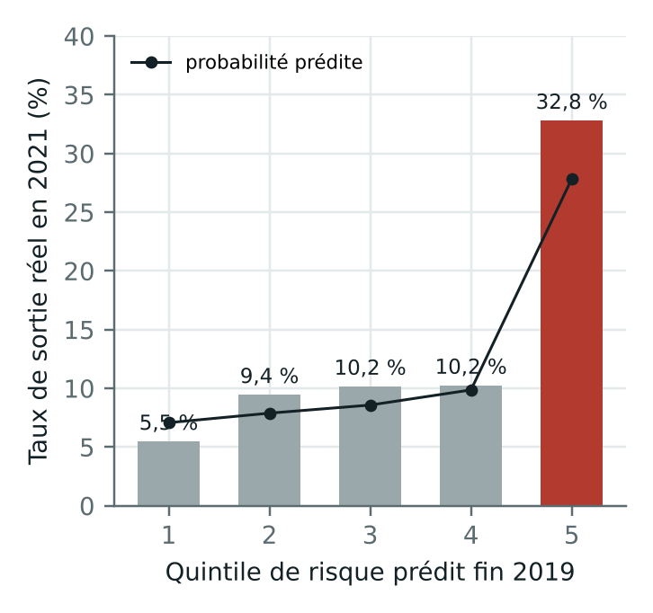

# Comptoir : le pétrole, du puits à la pompe, en chiffres

Sidy Ali Haidara · M1 Économétrie et Statistique, Université Paris 1 Panthéon-Sorbonne · octobre 2026

🌐 Site : https://liltop888.github.io/moteur-negoce-physique/
📄 Rapport (9 pages) : [`rapport/rapport_moteur_negoce.pdf`](rapport/rapport_moteur_negoce.pdf)

## Pourquoi ce projet

Je suis passionné par les hydrocarbures. Tout a commencé par la transformation des déchets en biocarburant.
Puis la crise du carburant au Mali, mon pays d'origine, m'a fait m'intéresser à la manière dont le pétrole
arrive (ou n'arrive pas) jusqu'aux gens. La crise d'Ormuz a renforcé cet intérêt. L'été dernier, en Alberta,
j'ai côtoyé plusieurs personnes du milieu pétrolier, et j'ai voulu comprendre leur métier avec des chiffres :
ce projet est né de là.

## Ce qui m'a surpris

Que les chiffres voient ce que l'intuition ne voit pas. Personne ne sait si le pétrole va monter ou baisser,
mais on peut dire avec une précision étonnante de combien il peut bouger : mes fourchettes à 90 % contiennent
le vrai prix environ 9 fois sur 10. Et l'intuition sous-estime toujours les krachs : une journée de −25 %
arrive bien plus souvent que ce qu'on imagine.

Et ce n'est qu'avec des données publiques. Je n'ai pas accès à ce qu'utilisent les grandes maisons de négoce :
images satellites des réservoirs, suivi des pétroliers en mer, données climatiques, consommation en temps réel.
Avec elles, on pourrait resserrer les fourchettes, et peut-être commencer à prévoir la direction,
pas seulement l'ampleur.

## Mon objectif

Apprendre, puis faire apprendre à ceux qui m'entourent. Mettre du carburant dans sa voiture ou allumer
son chauffage paraît acquis ; derrière, il y a un système immensement complexe qui reste dans l'ombre.
Et si ce projet m'ouvre la porte d'un stage ou d'un emploi dans le domaine pour l'approfondir,
ce serait une opportunité formidable.

---

## Le projet

Trois parties, toutes sur données publiques réelles :

1. **Qui financer** : repérer les petits producteurs texans en difficulté (production mensuelle de 12 163 opérateurs).
2. **Prix et risque** : ce que vaut vraiment un baril préfinancé (krachs, prix plancher, stockage, risque de défaut).
3. **Prévisions** : chaque lundi, une fourchette à 90 % pour le brut et les carburants, mise à jour automatiquement et notée après coup.

## 1. Qui financer

### La question

Un négociant qui préfinance un petit producteur de pétrole obtient une décote sur le prix,
mais s'expose à son défaut, qui survient surtout quand le prix chute. Combien rapporte
réellement un baril une fois les coûts et les risques déduits, et combien en acheter à chaque producteur ?

### Méthode

| Étape | Modèle |
|---|---|
| Prix du pétrole | Schwartz (1997) à un facteur, Ornstein-Uhlenbeck sur le log-prix, calibré sur le WTI 2015-2026, simulation exacte |
| Défaut lié au prix | Modèle structurel de Merton, point de défaut KMV, simulation conjointe prix-défauts |
| Défaut observé | Logit de sortie estimé sur la production mensuelle des 12 163 opérateurs du Texas |
| Rendement par baril | Décote, qualité du brut (API, soufre), hub de revente optimal, financement, perte attendue |
| Allocation | Programme linéaire CVaR de Rockafellar-Uryasev, scénarios regroupés par motif de défaut |

### Résultats principaux



- **Validation hors échantillon** : entraîné sur la crise de 2015, testé sans réajustement sur la crise de 2020,
  le modèle atteint une **AUC de 0,71** (IC 95 % bootstrap : 0,65-0,78), contre 0,66 pour le déclin seul.
  Le quintile le plus risqué a connu **six fois plus de sorties** que le plus sûr (32,8 % contre 5,5 %).
- **Ce qui prédit la sortie** : l'irrégularité de la production et la chute récente, pas le déclin sur un an.
- **Couverture** : sans futures, le gain moyen par baril varie de +3,89 $ à −3,36 $ selon la vitesse de retour
  à la moyenne retenue dans son intervalle de confiance ; couvert, il reste à 2,64 $.
- **Wrong-way risk** : quand les défauts suivent le prix, la perte extrême d'un portefeuille diversifié augmente
  de 79 % et la probabilité de défauts en chaîne passe de 4 % à 23 %.

## 2. Prix et risque du préfinancement

Quatre modules qui valorisent l'accord de préfinancement sur les prix journaliers du WTI (2010-2026) :

| Module | Méthode | Résultat clé |
|---|---|---|
| `sauts_extremes.py` | Merton à sauts, valeurs extrêmes (GPD), GARCH + EVT, tests de Kupiec et Christoffersen | Seul GARCH + EVT passe le backtest 2020-2026 (19 dépassements pour 16,9 attendus) |
| `plancher.py` | Put sous Schwartz (formule fermée), option sur moyenne par Monte Carlo + variable de contrôle | Plancher à 80 $ : 6,32 $/b ; variance divisée par 98 |
| `stockage.py` | Arrêt optimal : Longstaff-Schwartz contre programmation dynamique | À 50 $, attendre vaut 7,44 $ ; à 96 $, vendre tout de suite |
| `cva.py` | CVA avec intensité de défaut liée au prix (wrong-way risk) | 2,72 → 2,91 $/b |
| `deal.py` | Comparaison des structures 3/6/12 mois et portefeuille de 13 producteurs | Coût 1,51 $/b à 3 mois contre 6,04 $/b à 12 mois ; pire trimestre de crédit 6,7 M$ |

```bash
cd src/m2
python run_all.py     # résultats et figures dans resultats/m2/
```
Page du site : https://liltop888.github.io/moteur-negoce-physique/modeles.html

## 3. Prévisions hebdomadaires

Chaque lundi, une tâche GitHub Actions télécharge les prix officiels, recalcule les prévisions et met le site à jour :
WTI, Brent, essence et diesel au port de New York (EIA), essence et gazole à la pompe en moyenne dans l'UE
(Bulletin pétrolier de la Commission européenne).

- Modèle : GARCH(1,1) sur les rendements, puis simulation historique filtrée (4 000 trajectoires), fourchette à 90 %.
- Backtest sur 3 ans (156 dates) : la fourchette à une semaine contient le vrai prix 87 à 90 % du temps selon la série.
- Chaque prévision est ajoutée à [`docs/data/journal.csv`](docs/data/journal.csv) le jour même et n'est jamais modifiée.

Code : `src/previsions/` · Page : https://liltop888.github.io/moteur-negoce-physique/previsions.html

## Journal de bord

- **Octobre 2026** : première version sur le Texas (Python et Stata), backtest sur les crises de 2015 et 2020.
- J'ai ajouté une deuxième partie sur le prix et le risque du préfinancement (sauts, valeurs extrêmes, options, stockage, CVA).
- J'ai essayé de présenter le site comme une note de trading ; je ne m'y retrouvais pas, je suis revenu à la version précédente.
- Couleurs : du vert au bleu, puis au crème. Je voulais un site chaleureux, pas une interface froide.
- Prévisions : le panier OPEP est retiré, leur site bloque les téléchargements automatiques. Le fichier européen
  ne donne que la moyenne de l'UE, pas chaque pays.

## Prochaines étapes

- [ ] Carburants européens à un mois : la fourchette ne contient le prix que 70 à 77 % du temps (objectif 90 %).
      Les prix à la pompe évoluent par vagues lentes ; il faut en tenir compte dans le modèle.
- [ ] Rapprocher les « sorties » de producteurs texans des vraies faillites (Chapter 11) pour écarter les simples cessions de puits.
- [ ] Calibrer le modèle de prix sur la courbe des contrats à terme (Schwartz-Smith, filtre de Kalman).
- [ ] Ajouter le brut lourd canadien (WCS) dès que je trouve une source publique fiable.

## Reproduire

```bash
pip install -r requirements.txt
cd src
python calibrate.py ../data/wti_monthly_fred.csv     # calibration du modèle de prix
python producer_scoring.py --demo                     # chaîne complète sur producteurs fictifs
python texas_backtest.py --pdq ../data/PDQ_DSV --date 202605 --out ../resultats   # données réelles (voir data/README.md)
```

Version Stata/Mata du moteur : `stata/moteur_negoce.do` (Stata 16 ou plus récent).

## Structure

```
src/        calibrate.py · stochastic.py · producer_scoring.py · ml_portfolio.py
            texas_backtest.py · crude_quality.py · logistics.py · rrc_production.py
stata/      moteur_negoce.do
data/       prix du WTI, producteurs de démonstration (le fichier du Texas est à télécharger)
figures/    graphiques du rapport
rapport/    rapport PDF
resultats/  backtest_reference.json (résultats agrégés, sans noms d'opérateurs)
```

## Limites

Une « sortie » peut être une faillite ou une cession de baux ; la relation détresse-décote et les primes de hub
sont des hypothèses ; la vitesse de retour à la moyenne du prix est mal identifiée. Détails et extensions
(faillites Chapter 11, modèle de Schwartz-Smith par filtre de Kalman, modèle de survie) dans le rapport.

Les résultats nominatifs par opérateur ne sont pas publiés : ce sont des prédictions statistiques, pas des constats.

Licence MIT.
